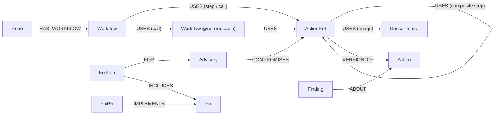

# ChainBreaker

**An AI incident agent for GitHub Actions supply-chain attacks: it finds every pipeline a compromised action really reaches, shows the exact `uses:` path behind each one, computes the fewest line changes that cut every attack path (FalkorDB `algo.maxFlow`), opens the fix PRs and re-scans until exposure is 0.**

**Track 01: Agents That Act on Connected Data** · WeMakeDevs × FalkorDB Graph Hacks

- **Demo video:** _add link_ · **Live:** _add URL_ (or run it locally in 3 commands, below)
- Graph: FalkorDB 4.22 (`falkordb/falkordb:latest`), one graph per dataset: `cb:demo`, `cb:cncf`, `cb:replay-tj-2025`

---

## The problem

In March 2025 a leaked SpotBugs token led to a compromised `reviewdog/action-setup@v1`, which `tj-actions/eslint-changed-files` depends on, which led to `tj-actions/changed-files` (used by 23,000+ repos), with `coinbase/agentkit` as the target ([Unit 42](https://unit42.paloaltonetworks.com/github-actions-supply-chain-attack/)).
**Most victims never referenced the compromised action directly.** They ran it through composite actions and reusable workflows, two to four `uses:` hops away, so a `grep` of their own workflow files finds nothing.

## What it does: the five moments

1. **Hidden depth.** Same question twice: at depth 1 (what `grep` finds) the demo org has **2** exposed pipelines; at full depth ChainBreaker finds **11**, of which **9 are hidden**, and **1 pinned its dependency to a SHA and is still exposed** (the pinned commit itself uses a mutable tag).
2. **A path behind every answer.** Every exposed pipeline opens to its shortest exposing path (`algo.SPpaths`), hop by hop, with the file and line of every `uses:`.
3. **Min-cut.** "**4 line changes** protect all 11 pipelines" (3 for the 9 high-value ones), computed by FalkorDB **`algo.maxFlow`** on a `GRAPH.COPY` scratch graph. The UI names the engine.
4. **Real action.** One click opens real PRs in the demo org; *Merge & continue* merges them, moves the `cb-lint-reporter@v1` tag to the fixed commit, opens and merges the REPIN PR for the SHA-pinned pipeline, re-crawls GitHub and rebuilds the graph: **exposure 0**.
5. **Honesty.** Unknown actions get "not in graph" plus suggestions. Every name in an agent answer is checked against this turn's tool results ("Grounded: 7/7"). The agent can only *request* approval for PRs.

**Scale proof:** the same analysis on **1,129 real public CNCF repos** (47 orgs, 4,556 entry workflows), with measured, aggregate-only numbers.

## Measured results (`cb eval`, [eval/RESULTS.md](eval/RESULTS.md))

**Demo org vs ground truth: 13/13 PASS**, covering the exposure set, per-workflow depth and severity, depth-1 = 2, hidden = 9, pinned-but-exposed = {mobile-app}, min cut 3 (high) and 4 (all) by `falkordb.algo.maxFlow`, and the GRAPH.COPY what-if → 0.

**CNCF** (crawled 2026-10-17; numbers are aggregates; repo and workflow names are pseudonymized as `repo-xxxxxx`):

| | |
|---|---|
| External `uses:` refs that are mutable (tag/branch) | **28.9%** of 13,485 |
| Entry workflows with ≥1 mutable ref anywhere in their chain | **34.8%** (1,586) |
| …reachable *only* through an intermediate action (invisible to grep) | **8.5%** (385) |
| Simulated compromise of the 20 highest-reach actions | **3,017** exposed workflows, **532 hidden (17.6%)**, **34 SHA-pinned but still exposed** |
| Fixing every HIGH pipeline | **864** line changes (min-cut) vs **927** naive |
| `actions/create-github-app-token` | **82% of its exposure is hidden**; min-cut **7** changes vs **20** naive |
| Speed | blast radius 40–65 ms per action; full plan (GRAPH.COPY + maxFlow) ≈ 0.55 s |

## Why a graph (Rule 3)

Exposure is a **multi-hop** property: a workflow is exposed if *any* chain of `uses:` (workflow → composite action → reusable workflow → … → compromised ref) reaches the bad ref. Fixing it optimally is a **max-flow / min-cut** problem over those chains. Neither is a flat lookup or a vector search. Without FalkorDB there is no answer: every number above is a Cypher traversal or a FalkorDB algorithm.

## Graph data model



| Label | Key properties |
|---|---|
| `Repo` | `id` (owner/repo), `stars`, `default_branch`, `redacted` |
| `Workflow` | `id` (`owner/repo:.github/workflows/x.yml`, `…@ref` for a reusable workflow at a ref), `triggers`, `secrets` (names only), `perms` (write/read/default), `id_token_write`, `prt`, `severity` + `severity_reasons`, `entry`, `at_ref`, `pinned` |
| `Action` | `id` (owner/repo[/path]), `search` (full-text) |
| `ActionRef` | `id` (`<action>@<ref>`), `ref`, `pinned` (40-hex SHA), `local`, `kind` (composite/node/docker/unknown/unresolved) |
| `DockerImage` | `id` (`docker://…`), `pinned` (`@sha256:`) |
| `Advisory` | `action_id`, `refs`, `known_good_sha` |
| `FixPlan` / `Fix` / `FixPR` | the cut, each `uses:` line change (PIN / REPIN / VENDOR, file, lines, old → new, protects), the PRs opened |
| `Finding` | agent memory: question, answer, date |

One relationship type, `USES` (with `kind` = step / call / image, plus `file_repo`, `file_path`, `lines`, `uses`, `src_immutable`), carries every dependency, so var-length traversals and `algo.maxFlow` run over a single type. Severity is deterministic: HIGH = `pull_request_target`, or secrets with write/default token permissions or `id-token: write`.

## Cypher queries and algorithms used (from [`chainbreaker/queries.py`](chainbreaker/queries.py))

The depth `{D}` is clamped to 1..8 and inlined: FalkorDB can't take a parameter as a var-length bound.

**Blast radius (exposed entry workflows and their minimum depth):**
```cypher
MATCH (:Advisory {id: $adv})-[:COMPROMISES]->(bad:ActionRef)
MATCH p = (w:Workflow)-[:USES*1..{D}]->(bad)
WHERE w.at_ref IS NULL AND w.entry = true
RETURN w.id AS workflow, w.repo_id AS repo, w.severity AS severity,
       w.severity_reasons AS reasons, min(length(p)) AS depth
```

**Pinned-but-exposed (the first hop of every exposing path is a SHA pin):**
```cypher
MATCH (:Advisory {id: $adv})-[:COMPROMISES]->(bad:ActionRef)
MATCH p = (w:Workflow)-[:USES*1..{D}]->(bad)
WHERE w.at_ref IS NULL AND w.entry = true
WITH w, collect(DISTINCT coalesce(nodes(p)[1].pinned, false)) AS first_pins
WHERE size([x IN first_pins WHERE x <> true]) = 0
RETURN w.id AS workflow
```

**Path evidence, `algo.SPpaths`:**
```cypher
MATCH (w:Workflow {id: $wid})
MATCH (:Advisory {id: $adv})-[:COMPROMISES]->(bad:ActionRef)
CALL algo.SPpaths({sourceNode: w, targetNode: bad, relTypes: ['USES'], weightProp: 'weight',
                   relDirection: 'outgoing', maxLen: {D}, pathCount: 1})
YIELD path, pathWeight
RETURN path, pathWeight ORDER BY pathWeight ASC LIMIT 1
```

**Min-cut, `algo.maxFlow`**, on a `GRAPH.COPY` scratch graph. Capacities: a line in an immutable (SHA-pinned) file = 10000; a line pointing at the compromised ref = 1 (**PIN**); a line pointing at a SHA pin = 1 (**REPIN**); else 3 (**VENDOR**).
```cypher
MATCH ()-[e:USES]->(b)
SET e.cap = CASE WHEN e.src_immutable = true THEN 10000 WHEN b.pinned = true THEN 1 ELSE 3 END

MATCH (w:Workflow) WHERE w.id IN $sources
WITH collect(w) AS srcs
MATCH (:Advisory {id: $adv})-[:COMPROMISES]->(b:ActionRef)
WITH srcs, collect(b) AS tgts
CALL algo.maxFlow({sourceNodes: srcs, targetNodes: tgts, relationshipTypes: ['USES'], capacityProperty: 'cap'})
YIELD nodes, edges, edgeFlows, maxFlow
RETURN nodes, edges, edgeFlows, maxFlow
```
The cut is read off the residual graph and validated twice: the cut capacity must equal `maxFlow`, and removing the cut must disconnect every source from every sink. A networkx min-cut is wired as a fallback; every run in this repo used `falkordb.algo.maxFlow`.

**What-if:** `GRAPH.COPY cb:demo → cb:demo:scratch:<hex>`, delete the plan's cut edges, re-run blast radius (→ 0), then delete the scratch graph (in `finally`, plus an atexit sweep).

**Load-bearing actions, `algo.pageRank`:**
```cypher
CALL algo.pageRank(null, 'USES') YIELD node, score
WITH node, score WHERE 'ActionRef' IN labels(node) AND node.local = false
MATCH (node)-[:VERSION_OF]->(a:Action)
RETURN a.id AS action, sum(score) AS pagerank ORDER BY pagerank DESC LIMIT 25
```
Plus transitive reach (`MATCH (w:Workflow)-[:USES*1..{D}]->(r)`), `algo.betweenness` for bridge composites, a full-text index on `Action.search` (`db.idx.fulltext.queryNodes`) for name resolution, and multi-graph (one graph per dataset, scratch graphs for what-ifs).

**Capability check** (`cb check`, FalkorDB `graph` module 42201): `algo.maxFlow` ✓, `algo.SPpaths` ✓, `algo.pageRank` ✓, `algo.betweenness` ✓, `algo.WCC` ✓, `algo.HarmonicCentrality` ✓. The probed `algo.maxFlow` output shape is recorded in [NOTES.md](NOTES.md).

## Agent design

- **Fixed tool catalogue, no LLM-written Cypher.** 10 parameterized tools (`find_action`, `simulate_compromise`, `blast_radius`, `explain_exposure`, `workflow_risk`, `plan_fix`, `simulate_fix`, `request_fix_approval`, `load_bearing_actions`, `recall_findings`), each a pydantic model turned into an Anthropic tool schema. Read tools use `ro_query`.
- **Four outcome shapes:** `answered_with_path`, `answered_from_memory` (with date), `not_in_graph`, `unknown_entity` (with suggestions).
- **Grounding validator:** every `owner/repo[/path][@ref]` or `repo-xxxxxx` in the final answer must appear in this turn's tool results (or the user's question). If any don't, the agent is asked once to rewrite; anything still unverified becomes `[unverified]`. The UI shows "Grounded: N/N".
- **Human approval gate:** the agent can only call `request_fix_approval`. Opening and merging PRs are admin-only endpoints behind a UI button.
- **Memory:** every answered question is stored as a `Finding` node; `recall_findings` returns them with dates.
- **MCP server:** the same tools (minus approval) over stdio, so Claude Desktop or any MCP client can query the graph.
- Model: `claude-sonnet-5-5` (env `ANTHROPIC_MODEL`), adaptive thinking, with server-side refusal fallback enabled.

## Setup (local)

```bash
uv venv --python 3.12 .venv && uv pip install --python .venv/bin/python -e ".[dev]"   # or python3.12 -m venv
cp .env.example .env            # fill GITHUB_TOKEN, DEMO_ORG, ANTHROPIC_API_KEY, ADMIN_TOKEN
docker compose up -d falkordb   # FalkorDB on 6379, Browser on http://localhost:3000
.venv/bin/cb snapshot-import --dataset demo && .venv/bin/cb snapshot-import --dataset cncf
.venv/bin/uvicorn chainbreaker.api:app --port 8000     # → http://localhost:8000
```

Or everything in Docker. On an empty volume the app imports the snapshots itself:

```bash
docker compose up -d --build falkordb app
```

Optional live data: `cb crawl --dataset cncf && cb load --dataset cncf` re-crawls the 47 CNCF orgs (≈7 min cold). `cb seed-demo` builds the synthetic demo org in your own `DEMO_ORG`, and `cb crawl --dataset demo && cb load --dataset demo` loads it. `cb eval` regenerates [eval/RESULTS.md](eval/RESULTS.md), and `pytest -q` runs the 45 tests.

CLI tour: `cb check`, `cb advisory`, `cb blast --depth 1|6`, `cb path`, `cb plan --targets high|all`, `cb simulate`, `cb apply-demo --open|--merge`, `cb rescan-demo`, `cb reset-demo`, `cb leaderboard`, `cb ask "…"`, `cb mcp-selftest`.

### MCP server (Claude Desktop)

```json
{
  "mcpServers": {
    "chainbreaker": {
      "command": "/ABSOLUTE/PATH/chainbreaker/.venv/bin/python",
      "args": ["-m", "chainbreaker.mcp_server"],
      "env": { "FALKORDB_HOST": "localhost", "FALKORDB_PORT": "6379", "FALKORDB_PASSWORD": "chainbreaker" }
    }
  }
}
```

## Deploy

`docker compose --profile prod up -d --build` on a personal VPS runs FalkorDB, the app and Caddy (automatic HTTPS; `DOMAIN` can be `chainbreaker.<ip-with-dashes>.sslip.io`). Set `PUBLIC_MODE=1` and a strong `ADMIN_TOKEN`. Public mode serves only the redacted CNCF snapshot, rate-limits the agent and refuses admin writes without the token.

## Data and ethics

Public data plus a synthetic demo org (`chainbreaker-lab-divy`, with GitHub Actions disabled on every repo). No secret values are ever fetched or stored, only secret *names* that already appear in public workflow files. CNCF repo and workflow names are pseudonymized in the committed snapshot; only public action names and aggregates are shown. PRs are only ever opened in our own org: every GitHub write helper asserts `owner == DEMO_ORG`.

## AI disclosure (Rule 11)

Built with AI assistance: Claude Code (Claude Opus 5.5) generated most of the code from a design plan ([PLAN.md](PLAN.md)). I (Divy) made the design decisions, reviewed and ran every checkpoint, and tested and deployed the system. Decisions and deviations from the plan are logged in [NOTES.md](NOTES.md).

## Limitations

- npm dependencies of JavaScript actions are not traversed; `uses:` is the only edge.
- Local `./` uses inside actions resolve against the caller's workspace and are left as unresolved leaves.
- Org-level default token permissions are not visible, so a workflow without a `permissions:` block is shown as "default" (treated like write).
- The crawl depth is capped at 6 hops (the deepest CNCF chain seen is 6).

## License

MIT
